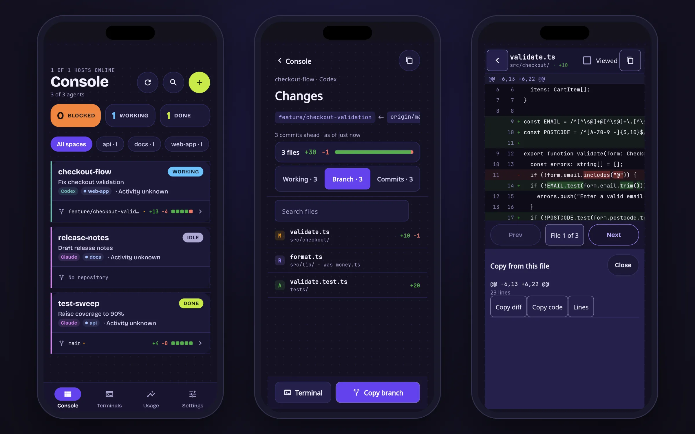
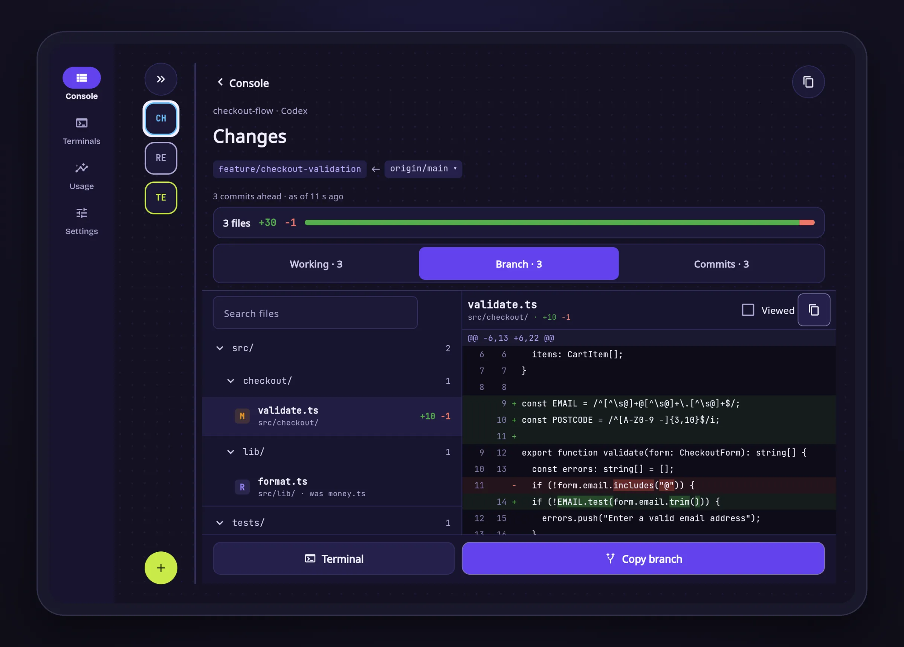

<p align="center">
  
</p>

<h1 align="center">RelayDeck</h1>

<p align="center">
  Watch and drive the coding agents and shells running on your Mac, from your phone, tablet or browser.
</p>

<p align="center">
  <a href="https://github.com/Hybridhash/relaydeck/actions/workflows/ci.yml"></a>
</p>

<p align="center">
  <a href="LICENSE">MIT License</a> ·
  <a href="CHANGELOG.md">Changelog</a>
</p>

<p align="center">
  
</p>

RelayDeck is a remote control for [Herdr](https://herdr.dev), the terminal workspace manager for AI coding
agents. Herdr keeps your agents and shells running on your Mac; RelayDeck lets you follow them, answer them
and start new ones from your phone, tablet or browser, anywhere on your private network.

<table>
  <tr>
    <td width="33%" valign="top"><b>Unblock agents from anywhere</b><br>See which agent is waiting, read its terminal and answer it in a tap, without walking back to your desk.</td>
    <td width="33%" valign="top"><b>Nothing leaves your Mac</b><br>No RelayDeck cloud and no account. Devices reach your Mac over your own tailnet, and each one is approved on the Mac.</td>
    <td width="33%" valign="top"><b>Know what your agents cost</b><br>Tokens, estimated cost and plan limits per tool and per space, read from each tool's own local logs.</td>
  </tr>
</table>

## Features

<p align="center">
  
</p>

- **Console**: every Herdr space, agent and shell at a glance, with live status (working, blocked, done).
- **Real terminals**: full terminal rendering with selection, copy, safe paste, control keys and a
  keyboard toolbar built for phones.
- **Three ways to type**: an agent composer for writing prompts, direct input for answering an agent's
  question, and an ordinary shell terminal. Unsent drafts are kept when you switch.
- **Changes**: each agent card shows its branch and uncommitted changes; open it to read the files that
  changed and their diffs, in the working tree or on the branch since its base, with commits, search
  and copy. Read-only: nothing is changed in the repository, and files that can hold secrets
  (`.env`, keys) are listed without their content.
- **Usage**: tokens, estimated cost and plan limits per tool and per Herdr space, with hourly, 7-day,
  30-day and 90-day charts.
- **Notifications**: a push notification when an agent is blocked or finished (Web Push, per-device
  choices).
- **Runs anywhere you are**: a web app for any browser, installable to the iPhone or iPad Home Screen.
  Native Android and iOS apps are in progress (see [Native apps](#native-apps-in-progress)).

## How it works

<p align="center">
  
</p>

Everything runs on your own Mac. A small **companion** process bridges your devices and Herdr.

- The companion listens on **loopback only** (`127.0.0.1`) and opens **no inbound port** on your Mac or
  router.
- Devices reach it through a **tailnet-only HTTPS address** from `tailscale serve`, for example
  `https://your-mac.your-tailnet.ts.net:8445`. Tailscale Funnel (public exposure) is refused.
- Every device must be **approved on the Mac** with a matching pairing code before it gets in.
- Usage data is read from local files and stays in a local database. Only numbers are kept; conversation
  text is never stored or sent anywhere.

## Usage tracking

<p align="center">
  
</p>

`relaydeck setup` offers each supported coding CLI it finds on your Mac as a usage source. Each tool shows
only what it really provides:

- **Tokens and estimated cost** from the tool's own local session logs.
- **Credits** for credit-metered tools.
- **Plan limits** (percent used and reset time) where the tool exposes them. For tools that show limits
  only on their own `/usage` screen, a refresh button reads them on demand.

RelayDeck reads these local files itself and stores only numbers, never conversation text. Plan limits come from
sources you enable: a tool's own cached status (through an optional hook that setup offers to install) or,
for tools that provide one, an on-demand query that runs that tool's own local command under your existing
login. RelayDeck does not store vendor credentials or send usage data to any vendor.

<sub>Screenshots use a synthetic demo workspace; no real sessions or usage are shown.</sub>

## Changes (git)

<p align="center">
  
</p>

Each agent card shows the branch its working folder is on and how many lines changed. Tap that row to
review the agent's work without leaving the phone:

- **Working**: uncommitted work (staged, unstaged and untracked files) compared with HEAD.
- **Branch**: everything the branch changed since it left its base, with its list of commits. The base is
  the remote's default branch unless you choose another one; your choice is remembered on the Mac.
- **Files and diffs**: a file list with search, a folder tree on wider screens, and a diff per file that
  loads in pages. Lock files and minified files are grouped apart. Mark a file as viewed to keep track of
  what you have read.
- **Copy**: copy a hunk as a diff (with its `+`/`-` signs) or as the new code only.

The view refreshes on its own while the agent works and more slowly when it is idle. On a tablet or a
wide window the folder tree and the diff sit side by side:

<p align="center">
  
</p>

It is read-only. Git runs on your Mac, RelayDeck never commits, checks out or fetches, and your repository's
helpers are switched off (no hooks, filters, external diff or pager). A repository whose own settings could
run programs is shown as unsupported instead. Files that usually hold secrets (`.env`, `.pem`, `.key`,
`id_*`, `credentials*` and anything inside a `secrets` folder) are listed without their content, and private
key blocks and common access tokens are masked in every diff. Viewing changes needs the same permission as
viewing terminals.

<sub>Screenshots use a synthetic demo repository; no real code is shown.</sub>

## Requirements

| What | Version / notes |
|---|---|
| macOS | Apple silicon or Intel |
| [Herdr](https://herdr.dev) | Protocol 22 (developed against 0.9.1), running on the Mac |
| [Tailscale](https://tailscale.com) | Logged in, with **MagicDNS** and **HTTPS certificates** enabled for your tailnet |
| Python | 3.13 (installed automatically by `uv` with `--managed-python`) |
| [uv](https://docs.astral.sh/uv/) | Any recent version; the installer installs it if yours is missing |
| Devices | A browser on your tailnet, or the iPhone/iPad Home Screen web app |

## Install

Two commands set up a Mac, and a third pairs each device. You need no clone, no Flutter and no
hand-edited file.

### 1. Install the companion

Download the installer script from the release (over HTTPS), read it, then run
it. It checks its wheel against the SHA-256 inside it, installs `uv` first if
yours is missing, installs RelayDeck, and ends in `relaydeck setup`, which
checks everything else and fixes what it safely can. The web app and the
update record are the signed parts; setup verifies those separately.

```sh
d=$(mktemp -d) && curl -fsSL -o "$d/install.sh" https://github.com/Hybridhash/relaydeck/releases/download/v0.3.0/install.sh && /bin/sh "$d/install.sh"
```

The `companion` extra carries the server parts (FastAPI, uvicorn and the Flet web mount). Always install
it on the Mac.

### 2. Run setup

```sh
relaydeck setup            # everything below, in order, asking before each change
relaydeck setup --check    # read-only readiness report: what is ready, what is not, and the next step
```

Setup checks Herdr, Tailscale, `uv` and Python first. If Herdr is missing it offers to install it with
Herdr's own installer; if Tailscale is missing, stopped or signed out it offers to open it (or its
download or DNS page) for you to finish. It never starts Herdr: when Herdr is installed but not
answering, setup asks you to open it in another terminal window and waits up to five minutes (open
Herdr again after a restart or login; RelayDeck's login service does not start it). If a prerequisite
is still not ready, setup stops before writing any RelayDeck file. Git 2.45 or newer is needed only for
the Changes screen; without it setup finishes and tells you to run `xcode-select --install`.
Then it works through these steps and tells you what each one did ("created" or "present (not
changed)"):

1. **Private files**, one question: the config with this Mac's own private address, the two secret
   files (cookie and cursor, 32 random bytes each, different), the connector key, and this Mac's
   enrollment. Everything is owner-only; no secret is ever printed. Anything already there is kept as
   it is, and a file that is unsafe (a link, readable by others, too short, the same as the other
   secret) is reported and left alone for you to fix.
2. **Agent kinds**: which installed agent CLIs your devices may start (default no).
3. **Usage sources, plan limits, probe-folder trust and the limits hook**: one question per item,
   default no.
4. **Tailscale Serve**: the private HTTPS mapping to this companion. `--yes` answers this question
   and the prerequisite questions above (install Herdr, open Tailscale), nothing else. Funnel is
   never used.
5. **Web app**: downloads the signed web bundle for the installed version from GitHub and installs it
   only if its signature verifies against the key in [`minisign.pub`](minisign.pub).
6. **Start at login**: installs and loads a per-user login service, or, if you say no, leaves
   RelayDeck configured but not running (start it with `relaydeck start --connect-herdr`).
7. **Wait until running**, then checks the private HTTPS address answers.
8. **Pair a device now**: the same flow as `relaydeck pair`.

Setup never answers a question for you except Serve and the install/open questions with `--yes`: usage
sources, limits, trust, agent kinds, hooks, enrollment, the login service and pairing are your
choices. While setup writes the private files it holds
the companion's lock, so a companion cannot start meanwhile (`relaydeck status` shows it as not
running); if one is running, setup asks before stopping it. A second `relaydeck setup` changes nothing
and asks nothing that is already done. To replace this Mac's connector enrollment on purpose, run
`relaydeck setup --re-enroll`; the old connector token stops working. Without a terminal, setup prints
the pending steps and writes nothing.

Device sign-ins are kept in memory unless durable sign-ins are enabled (`RELAYDECK_DURABLE_SIGNINS=1`
and the Mac key store available); the last line of setup says which applies.

### 3. (Optional) Herdr plugin

The Herdr plugin adds three popup actions in Herdr: **RelayDeck: Set up** (`relaydeck setup`),
**RelayDeck: Pair a device** (`relaydeck pair`: you approve each device there by typing its code) and
**RelayDeck: Status** (read-only status and doctor). It only launches the installed `relaydeck`
commands, installs nothing and never approves a pairing on its own. It is optional: the same commands
are available from the `relaydeck` CLI. Install RelayDeck first (step 1), then:

```sh
herdr plugin install Hybridhash/relaydeck/plugin --ref v0.3.0
```

Herdr shows a preview of the manifest and commands before confirming. To remove it later:
`herdr plugin uninstall relaydeck`. While developing, link a local checkout instead:
`herdr plugin link <clone>/plugin`.

### 4. Pair a device (and more devices later)

```sh
relaydeck pair
```

`relaydeck pair` opens a pairing window (five minutes by default; `--ttl <seconds>` up to 300), shows
the private address to open on the device, and lists each request with the device's name. **Type the
code the device shows.** It approves only when what you type matches exactly one waiting request;
anything else approves nothing and asks again. `d` denies the only waiting request (`d <code>` picks
one when several wait), Enter keeps waiting, and Ctrl-C closes the window. No flag approves for you.

A paired device stays signed in for up to 30 days after its last use. On iPhone or iPad, use Safari's
**Share → Add to Home Screen**, open RelayDeck from the Home Screen, then tap **Get notifications** to
receive alerts.

### Advanced: separate gateway or manual setup

`relaydeck setup` does all of this itself. Use these commands only when you run the gateway apart from
the companion, or want to do a step by hand. The connector key is one per user, at
`~/.config/relaydeck/connector_key.json`, whichever profile you run.

1. The two secret files named in `companion.toml` (`cookie_secret_file`, `cursor_secret_file`): mode
   0600 in an owner-only folder, each at least 32 bytes, different from each other:

   ```sh
   (umask 077; openssl rand -hex 32 > ~/.config/relaydeck/cookie.secret)
   (umask 077; openssl rand -hex 32 > ~/.config/relaydeck/cursor.secret)
   ```

2. Create the connector key and print its public line (never run `keygen --force` unless you mean to
   re-enroll: it replaces the key):

   ```sh
   relaydeck-connector keygen
   relaydeck-connector fingerprint
   ```

3. Start the companion first, **without** the Herdr connection, so a network redeem can reach it
   (`relaydeck start` stays in the foreground). In a second terminal, issue the invitation and redeem
   it with the id and code that `issue-enrollment` prints and the `host_id` from your
   `companion.toml`, then stop the first one and start it again with the Herdr connection:

   ```sh
   relaydeck start                     # first terminal
   relaydeck-gateway issue-enrollment --host-label "My Mac" --pubkey "<ssh-ed25519 line>" \
     --account owner --origin https://your-mac.your-tailnet.ts.net:8445 --ttl-seconds 600 \
     --store "$HOME/Library/Application Support/RelayDeck/enrollments.json"
   relaydeck-connector enroll --gateway https://your-mac.your-tailnet.ts.net:8445 \
     --id <enr_...> --code <XXXX-XXXX-XXXX> --host home-mac
   relaydeck stop
   relaydeck start --connect-herdr
   ```

4. The web app from a clone, instead of the signed release bundle (needs Flutter 3.44.8 at
   `~/flutter/3.44.8`):

   ```sh
   git clone https://github.com/Hybridhash/relaydeck.git && cd relaydeck && git checkout v0.3.0
   uv sync --locked --extra companion --group dev
   scripts/build_web_client.sh ~/relaydeck-web
   FLET_WEB_PATH=~/relaydeck-web relaydeck start --connect-herdr
   ```

   The companion serves only the signed bundle for its own version unless `FLET_WEB_PATH` names
   another one. A bundle chosen this way is a developer bundle: `relaydeck setup --check` shows it as
   such and does not count it as the signed release.

5. The login service by hand: `relaydeck service install --yes --load`.

### Native apps (in progress)

<p align="center"></p>

Native Android and iOS apps are in progress and not yet released. Until then, use the web app above on
any device. Developers can build the Android app from source with `scripts/build_native.py`
(`stage --platform android`, then `build --platform android --run`); pins and build notes are in
[patches/README.md](patches/README.md).

## Daily use

With the companion running, open the private address on any paired device. The Console lists every
agent and shell; open one to read its terminal, send a prompt or answer a blocked agent. Check on the
companion from the Mac with `relaydeck status`, stop it with `relaydeck stop`, and start it again with
`relaydeck start --connect-herdr` (or let the login service do it).
## Updating

See the [updating guide](docs/releasing/README.md).

## Privacy

RelayDeck normally checks once a day for a newer release by downloading a small public file and its
signature from GitHub (github.com and its download servers). GitHub sees your IP address, the time and
a standard HTTP client name, as with any download; a failed check may retry after six hours. No
account, terminal, repository or usage information is sent. Turn it off with `[updates]` `check =
false` in companion.toml or at `relaydeck setup`. A config written before 0.3.0 has no `[updates]`
table and checks by default.

### Client data

The client receives terminal output, repository views and usage measurements
from the paired Mac. Prompts, keystrokes and selected pictures travel to that Mac;
the tools running there may then use their own external services. Do not submit
secrets you do not want those tools to receive.

Native credentials and account-scoped drafts use device secure storage. Native
drafts have no automatic seven-day expiry; they remain until explicitly deleted
or the account storage is cleared. Hosted browser sign-ins use an HttpOnly cookie;
durable hosted sign-ins and drafts depend on protected storage on the Mac. Those
hosted drafts expire after seven days without access and are bounded in size.
When persistence is deliberately absent, drafts live in page-owned memory for
the page/account lifetime, with no durable recovery. A configured secure-store
failure is reported and does not fall back to plaintext storage.

Non-secret terminal preferences and Console pins use optional device/browser
key/value storage. Usage-space pins are saved separately for each account and
host. If that storage is unavailable, defaults and session memory keep the UI
working, but changes may not survive closing it. These settings are separate
from secure credentials and drafts. Signing out clears local account credentials
and native secure drafts and attempts server revocation; it does not erase
ordinary preferences, pins, usage history, command records or backups.

RelayDeck sends no application analytics to its maintainers. GitHub update
checks and optional push-service requests still make network connections.

The browser caches application assets for reuse. Optional push notifications
contact the browser's push service with encrypted messages containing opaque
references, category and timestamps, not terminal text or commands. Device
notification settings control their display. See [Uninstall](#uninstall), the
[retention, recovery and removal guide](docs/development/recovery.md) and
[credential lifetimes](docs/development/compatibility.md).

## Uninstall

<details>
<summary>How to remove RelayDeck completely</summary>

```sh
relaydeck service uninstall --yes --unload      # only if you installed the login service
relaydeck stop
tailscale serve --https=8445 off                # removes the private address mapping
uv tool uninstall relaydeck
rm -rf ~/.config/relaydeck "$HOME/Library/Application Support/RelayDeck"   # config, sign-ins, usage data
```

</details>

## Troubleshooting

<details>
<summary>Common checks and where the logs are</summary>

- `relaydeck setup --check` prints a read-only readiness report with the next step for each check.
- `relaydeck-companion doctor` reports the companion, Herdr socket, Tailscale and pairing state as JSON
  (`doctor --probe-private` also tests the private HTTPS address).
- **Usage limits stopped updating, or the Usage screen says "Setup needed"**: run `relaydeck usage doctor` to see
  why for each tool. If a tool's settings file was replaced, `relaydeck usage repair` puts back only RelayDeck's
  setting; it shows what it will change and asks first, keeps every other field, and never overwrites a status
  line you configured yourself.
- Logs for the login service are in `~/Library/Logs/RelayDeck/`.
- **The companion looks stalled**: with its pid from `relaydeck status`, run `kill -USR1 <pid>` to dump the
  thread stacks to its log (stack locations only, no data; it does not stop the companion).
- A device that cannot reach the address needs to be signed in to the same tailnet; the address is never
  public.

</details>

## Development

See the [development guide](docs/development/README.md).

## More

- [Changelog](CHANGELOG.md)
- [Contributing](CONTRIBUTING.md)
- [Architecture](docs/architecture/README.md)
- [Security policy](SECURITY.md)
- [Accessibility](docs/accessibility.md)
- [Third-party software and licences](docs/acknowledgements.md)

## License

RelayDeck is released under the [MIT License](LICENSE). Third-party components keep their own licences;
see [docs/acknowledgements.md](docs/acknowledgements.md).
